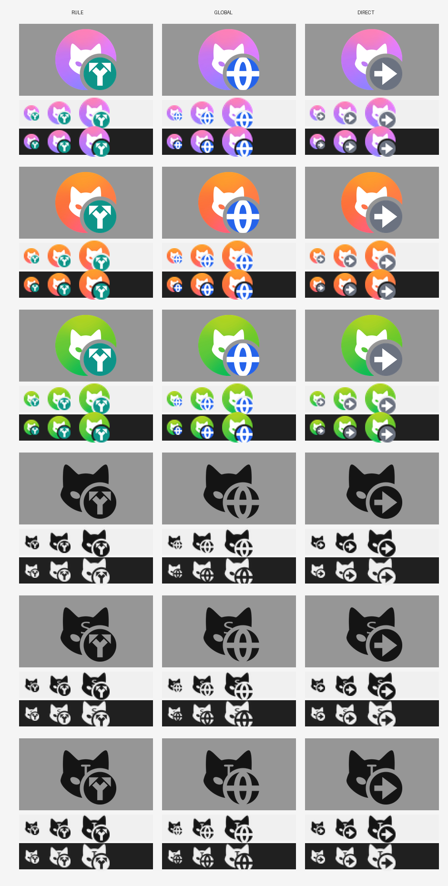

# Clash Verge Rev 个人修改版

本仓库基于官方 [clash-verge-rev](https://github.com/clash-verge-rev/clash-verge-rev) 的稳定版 tag 修改，只加了下面列出的功能，其余与官方一致。

| 项目 | 内容 |
|---|---|
| 当前基于 | `v2.5.8` |
| 修改分支 | `feature/tray-mode-icon` |
| 打包方式 | 本地编译（Windows），或 GitHub Actions 云端打包（全平台，见下文） |

## 修改内容：托盘图标显示出站模式

官方版本只在切换「系统代理 / TUN」时改变托盘图标，切换出站模式（规则 / 全局 / 直连）时图标不变，必须点开托盘菜单才能看到当前模式。

本版本在托盘图标右下角加了符号角标：

| 角标 | 出站模式 | 颜色（彩色图标） |
|---|---|---|
| 分叉箭头 | 规则 Rule | 青绿 |
| 地球 | 全局 Global | 蓝 |
| 直线箭头 | 直连 Direct | 灰 |

底色含义不变：粉紫 = 普通，橙 = 系统代理，绿 = TUN。另外，鼠标悬停提示中增加了一行「出站模式」。



上 3 行是 Windows / Linux 使用的彩色图标，下 3 行是 macOS 使用的黑白模板图标。

说明：

- 设置了「自定义托盘图标」时仍使用自定义图标，不显示角标。
- 通过 Clash Verge 自身（托盘菜单、主界面、代理页、快捷键）切换模式时图标会立即更新。
- 若开启了外部控制器，并通过网页面板（Yacd、MetaCubeXD 等）直接修改 mihomo 的模式，图标和托盘菜单的勾选都不会跟着变（官方版本的托盘菜单也有此问题）。

### 改动的文件

| 文件 | 说明 |
|---|---|
| `src-tauri/src/core/tray/mod.rs` | 按「代理方式 × 出站模式」选择图标，悬停提示增加出站模式 |
| `src-tauri/src/feat/effects.rs` | 修改模式时同时刷新悬停提示 |
| `src-tauri/icons/tray-icon*-{rule,global,direct}.ico` | 18 个新图标（原有图标保留，作为生成脚本的底图） |
| `fork/` | 本修改版专用的脚本、配置与预览图，与官方文件分开存放，减少 rebase 冲突 |
| `.github/workflows/fork-build.yml` | 手动触发的全平台打包工作流 |
| `FORK.md`、`README.md` 顶部 2 行 | 本说明 |

## 安装使用注意

1. **关闭自动检查更新**（设置 →「杂项设置」→「自动检查更新」）。否则官方发布新版本后会自动更新为官方版，本修改会被覆盖。
2. 安装包没有代码签名：Windows 会提示「未知发布者」，选择「仍要运行」即可；macOS 会提示「已损坏」，在终端执行 `xattr -cr "/Applications/Clash Verge.app"` 后再打开。
3. 版本号与官方相同，安装时会直接覆盖已安装的官方版。

## 编译环境（Windows）

> 当前开发机已卸载本地编译环境，只改代码，统一用 GitHub Actions 打包（见下文）。
> 项目自带的 git 提交/推送钩子依赖 Rust 和 pnpm，因此已在本地关闭（取消了 `core.hooksPath`），`git commit` / `git push` 不会再做格式检查。
> 以后如需本地编译，按下表重新安装后执行 `pnpm install`，会自动重新启用这些钩子。

为节省 C 盘空间，工具尽量安装在 D 盘：

| 工具 | 位置 | 说明 |
|---|---|---|
| MSVC Build Tools 2022 | `D:\BuildTools\2022` | 只装「VC x64 编译器」+「Windows 11 SDK」；SDK 固定装在 C 盘 |
| Rust（rustup） | `D:\Rust` | 用户环境变量 `RUSTUP_HOME=D:\Rust\rustup`、`CARGO_HOME=D:\Rust\cargo`；工具链版本由仓库的 `rust-toolchain.toml` 自动决定 |
| pnpm（独立版 exe） | `D:\Tools\pnpm\pnpm.exe` | 版本需与 `package.json` 中的 `packageManager` 一致 |
| Node.js | 系统已安装 | 22.x 可用 |

如果官方升级了 pnpm 版本，从 [pnpm releases](https://github.com/pnpm/pnpm/releases) 下载对应版本的 `pnpm-win-x64.exe`，替换 `D:\Tools\pnpm\pnpm.exe` 即可。

## 编译打包

在仓库根目录执行：

```bash
pnpm install --frozen-lockfile
pnpm run prebuild
pnpm build -c fork/tauri-no-updater.json
```

- `prebuild` 会从 GitHub 下载 mihomo 核心和规则数据库，网络不通时需要开代理。
- `-c fork/tauri-no-updater.json` 关闭「生成更新包」。更新包需要官方的签名私钥，不关闭的话打包最后一步会报错。
- 生成的安装包：`target\release\bundle\nsis\Clash Verge_<版本>_x64-setup.exe`
- 首次编译约 15～20 分钟；`target` 目录约 5 GB，可随时删除，删除后下次重新完整编译。

## GitHub Actions 云端打包（全平台）

工作流文件：`.github/workflows/fork-build.yml`，**只能手动触发**，不会自动运行。

1. 打开仓库的 Actions 页面 → 左侧选择 **Fork Build** → 右侧点 **Run workflow**。
2. 选择分支（`feature/tray-mode-icon`），勾选要打包的平台（默认 7 个全选）。
3. 需要发布到 Release 页面时，勾选 **Publish a GitHub Release**，否则只生成临时下载文件。
4. 点 **Run workflow**，等待 30～40 分钟（之后有编译缓存会快一些）。

| 平台 | 产物 |
|---|---|
| Windows x64 / ARM64 | `.exe` 安装包 |
| macOS Apple Silicon / Intel | `.dmg` |
| Linux x64 / ARM64 / ARMv7 | `.deb`、`.rpm` |

下载位置：

- **不发布 Release**：在这次运行的页面底部「Artifacts」中下载，每个平台一个 zip，保留 90 天。
- **发布 Release**：仓库 Releases 页面会出现 `fork-v<版本>-<运行编号>`，附件即各平台安装包，永久保留。部分平台编译失败时，Release 只包含成功的平台，可单独重新运行失败的平台后再发布一次。

### 停用官方的工作流

仓库里带着官方的工作流文件。其中两个会在本仓库自动运行，需要在网页上停用（Actions 页面 → 选择该工作流 → 右上角「···」→ **Disable workflow**）：

| 工作流 | 原因 |
|---|---|
| `autobuild.yml` | 每天北京时间 6:00、18:00 定时运行 |
| `release.yml` | 推送 `v*.*.*` 格式的 tag 时运行 |

停用状态保存在 GitHub 仓库设置中，不修改文件，因此不影响 rebase。不要删除这些文件，否则每次 rebase 都可能冲突。

## 跟进官方新稳定版

官方发布新的稳定版（例如 `v2.6.0`）后：

```bash
git fetch upstream --tags
git switch feature/tray-mode-icon
git rebase --onto v2.6.0 v2.5.8
```

`rebase --onto <新 tag> <旧 tag>` 把「旧 tag 之后的本修改」搬到新 tag 上。之后每次升级，把 `<旧 tag>` 换成上一次基于的版本，并更新本文开头表格中的「当前基于」。

可能出现冲突的地方：

- `src-tauri/src/core/tray/mod.rs`：官方改动了 `get_tray_icon` / `default_icon` / `update_tooltip` 附近的代码时。
- `src-tauri/src/feat/effects.rs`：官方改动了 `mode` 对应的 effect 列表或其测试时。
- `README.md` 顶部：官方改动了 README 开头时。

解决冲突后执行 `git rebase --continue`，然后在本地重新执行上面的「编译打包」三条命令，或者推送后用 GitHub Actions 打包。推送命令：

```bash
git push --force-with-lease origin feature/tray-mode-icon
```

rebase 会改写提交历史，所以推送必须带 `--force-with-lease`，这是正常的。

## 修改图标

图标由脚本生成：在原图标右下角叠加几何绘制的符号角标，输出与原图标相同的 PNG 压缩 ICO。只需要 Python（Pillow）。

托盘实际只用 ICO 里最大的 256px 帧，由系统缩小到托盘尺寸，所以调整时以预览图里缩小后的效果为准。

```bash
python fork/gen-tray-mode-icons.py src-tauri/icons <临时输出目录>
python fork/preview-tray-mode-icons.py src-tauri/icons <临时输出目录> fork/tray-mode-icons-preview.png
```

角标颜色（`MODE_COLOR`）、各尺寸的直径和透明间隙（`BADGE`）在脚本开头，符号形状在 `glyph_mask`。确认预览满意后，把输出目录中的 `.ico` 复制到 `src-tauri/icons/`。
